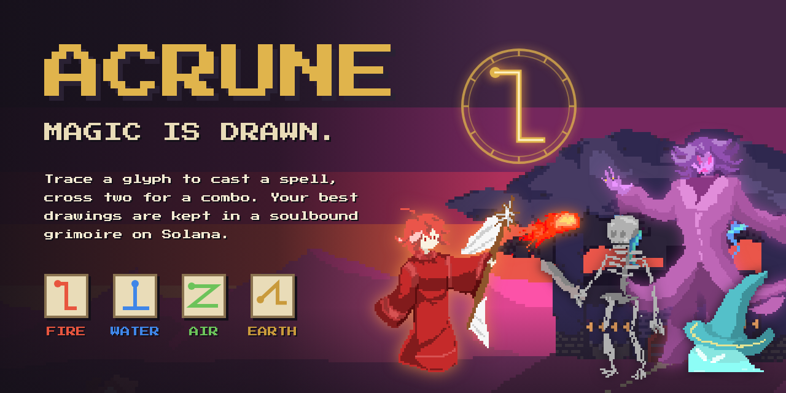

# Acrune: Magic Is Drawn

[](https://github.com/erdxcc/acrune/actions/workflows/ci.yml)
[](LICENSE)
[](https://explorer.solana.com/address/D5kYrvq47QFuqrNyj7TVT3mgWHCqqebuYDaPyvFgxJDo?cluster=devnet)
[](https://idosgames.com/app/BVTWU78A/)
[](https://www.colosseum.com)

> A pixel-art battle game where every spell is a glyph you draw, and your grimoire lives on Solana as a soulbound NFT filled with your own strokes.

[Play on idosgames.com](https://idosgames.com/app/BVTWU78A/) · [Full screen](https://acrunee.vercel.app/) · [Docs](docs/) · [Grimoire collection](https://explorer.solana.com/address/D5kYrvq47QFuqrNyj7TVT3mgWHCqqebuYDaPyvFgxJDo?cluster=devnet)

---



---

## Submission to the Colosseum Crypto World's Fair

Superteam Kazakhstan × iDos Games side track.

| Name | Role | Contact |
|------|------|---------|
| Yerdaulet Zhumagali | Code, gameplay, Solana and iDos integration | [GitHub](https://github.com/erdxcc) |
| Nabiulla Zhalel | Art, animation and music | @nabichoktr |

---

## Problem and Solution

### 1. Wallets get in the way of playing
- **Problem:** web3 games ask for a wallet, a signature and gas before the first battle, and inside a portal's iframe a game cannot ask a wallet to sign at all.
- **Acrune:** you start as a guest and can play the whole chapter. A relayer signs and pays for every write, and you link a wallet when you want your grimoire on chain.

### 2. NFTs are bought, not made
- **Problem:** most game NFTs are items anyone can buy, so they say nothing about the player who holds them.
- **Acrune:** the grimoire is soulbound and every page is a glyph drawn by its owner's hand. Its image is rendered from those strokes, so no two grimoires look alike.

### 3. On-chain progress is easy to fake
- **Problem:** when the client reports the result, anyone can write a win they never earned.
- **Acrune:** the relayer checks the iDos session with iDos, takes the wallet the player linked by signature, re-recognises every drawing and counts a win only when it is plausible.

### 4. Spells are just buttons
- **Problem:** in most battle games casting a spell means pressing a button, so skill comes down to timing.
- **Acrune:** magic is drawn. Precise glyphs hit harder, two crossed glyphs make a combination, and the opposite element drawn in time parries an enemy's cast.

---

## Why Solana

- **Metaplex Core** keeps a whole grimoire in one asset: `AppData` holds the pages, `Attributes` the chapter stats, and `PermanentFreezeDelegate` on the collection makes every grimoire soulbound.
- **Cheap, fast writes** let the relayer pay for every page a player earns and confirm it while the result screen is still up.
- **Wallets linked through iDos** tell the relayer whose grimoire to write without trusting the client.
- **Same code on mainnet:** a wallet has the same address on every cluster, so moving takes a new RPC URL and collection, not new code.

---

## Summary of Features

- Four elements drawn as one-stroke glyphs and recognised by a $Q point-cloud recognizer, with a finger or a mouse
- Accuracy scoring: precise drawings hit 1.5× harder, sloppy ones can backfire
- Combinations by crossing two glyphs: steam, ice and magma
- Parries: draw the opposite element before an enemy's spell lands
- Chapter 1: four locations, enemies one at a time, a boss whose weakness changes between phases
- Spell pages to choose before each battle, within a page limit that grows through the chapter
- A soulbound grimoire NFT on Solana with your best drawing of each spell
- Gasless writes through a relayer that checks everything with iDos first
- Guest play on iDos Games, wallet linking later, and an offline mode for development

---

## How to Play

- Draw inside the circle on the grimoire page (finger or mouse). Each glyph is one stroke of straight lines; the dot on its picture in the grimoire shows where to start:
  - fire: a step ‾|_ (a bar to the left at the top, down, a bar to the right)
  - water: ⊥ (down the stem, then along the base, going back over one half of it)
  - air: Z
  - earth: a 1 on its base, /|_
- **Accuracy matters.** Precise drawings hit 1.5× harder. Sloppy ones are unstable and can backfire on you. Unrecognised drawings fizzle and cost no mana.
- **Opposites:** fire ↔ water, air ↔ earth. Enemies are weak to the opposite of their element.
- **Parry:** when an enemy mage raises its staff, sparks of its element gather above it. Draw the opposite before the spell lands. The grimoire shows which glyph parries the next attack.
- **Combinations:** draw the first glyph, lift, and within 0.65 s draw the second one across it, for example fire × water = steam. While the first glyph waits, the circle shows which glyphs would complete a combination; the grimoire page shows each recipe. A combination parries the combination of opposites, so ice and magma parry each other.
- **Pages:** before each battle you choose which spells to take within a page limit. The limit grows through the chapter.

The chapter has four locations, and their enemies come out one at a time, each walking in after the last one falls: three slime mages; two slimes and then a skeleton mage; skeleton, skeleton mage, skeleton; and the boss, whose weakness changes between phases. The preparation screen shows each enemy's weakness and the glyphs that parry its spells. The first battle teaches drawing and then parrying (it pauses on the first enemy cast); the third teaches combinations with a hand that draws one.

---

## Tech Stack

| Layer | Technology |
|-------|-----------|
| Game | TypeScript · Phaser 4 · Vite |
| Glyph recognition | $Q point-cloud recognizer written for the game (`packages/glyphs`) |
| Battle | Deterministic simulation at 60 Hz in plain TypeScript |
| Relayer | Node.js · Hono · Vercel |
| On-chain | Solana devnet · Metaplex Core · Umi |
| Platform | iDos Games: hosting, accounts, saves, linked wallets |
| Testing | Vitest · GitHub Actions |
| Art pipeline | Python (uv) converter for the artist's sources |

---

## Architecture

```
Browser / idosgames.com iframe            Relayer (Vercel, Hono)                  Solana devnet
┌──────────────────────────────┐   fetch  ┌──────────────────────────────┐ Umi   ┌──────────────────────┐
│ Vite + TypeScript + Phaser 4 │ ───────▶ │ checks the iDos ticket       │ ────▶ │ Acrune Grimoires     │
│ battle simulation (pure TS)  │          │ reads the linked wallet      │       │ soulbound assets:    │
│ $Q glyph recognizer          │          │ verifies drawings, progress  │       │ Attributes + AppData │
│ @idosgames/core: login, saves│          │ writes with mpl-core         │       └──────────────────────┘
└──────────────────────────────┘          └──────────────────────────────┘
```

See [docs/architecture.md](docs/architecture.md) for the components, the on-chain format, the anti-cheat checks and deployment, and [docs/api.md](docs/api.md) for the relayer's endpoints.

---

## Quick Start

**Prerequisites:** Node.js 20+, pnpm 9

```bash
# Clone the repository
git clone https://github.com/erdxcc/acrune
cd acrune

# Install dependencies
pnpm install

# Run the tests
pnpm test

# Start the game on http://localhost:5173 (offline mode)
pnpm dev
```

Relayer with devnet writes:

```bash
cd apps/relayer
pnpm keygen               # writes .env with a fresh relayer key and secrets
pnpm airdrop              # or fund the printed address at https://faucet.solana.com
pnpm collection           # creates the soulbound collection, saves COLLECTION_ADDRESS
pnpm spike                # end-to-end devnet check: create, write, update, refuse transfer
pnpm dev                  # http://localhost:8787
```

Point the game at a title and the relayer with `apps/game/.env`:

```bash
VITE_IDOS_TITLE_ID=ABCD1234-DEV
VITE_RELAYER_URL=http://localhost:8787
```

The glyph recognizer can be evaluated on synthetic drawings with `pnpm --filter @grimoire/glyphs evaluate`.

---

## Roadmap

- [x] Glyph recognizer, combinations and parries
- [x] Chapter 1: four locations and a boss with phases
- [x] Soulbound grimoire on Solana devnet, written by a gasless relayer
- [x] Live on iDos Games
- [ ] Grimoires on mainnet
- [ ] More chapters, each with its own boss
- [ ] The rest of the combinations

Full roadmap: [docs/roadmap.md](docs/roadmap.md)

---

## Resources

- [Play on idosgames.com](https://idosgames.com/app/BVTWU78A/)
- [Full screen](https://acrunee.vercel.app/)
- [Grimoire collection on Solana Explorer](https://explorer.solana.com/address/D5kYrvq47QFuqrNyj7TVT3mgWHCqqebuYDaPyvFgxJDo?cluster=devnet)
- [Relayer health](https://acrunee.vercel.app/health)
- [Product](docs/product.md) · [Architecture](docs/architecture.md) · [API](docs/api.md) · [Submission texts](docs/submission.md)

---

## Credits

- Art, animation and music: Nabiulla Zhalel.
- Pixel font: Press Start 2P by CodeMan38, SIL Open Font License (`apps/game/public/fonts/OFL.txt`).
- Glyph recognition after $Q (Vatavu, Anthony, Wobbrock, 2018).

---

## License

The code is MIT, see [LICENSE](LICENSE). The art and music are not covered by it: the sources in `assets/` and the sprites, backgrounds and music made from them (`apps/game/public/assets`, `apps/game/public/audio`) belong to Nabiulla Zhalel. The font keeps its own SIL Open Font License.
